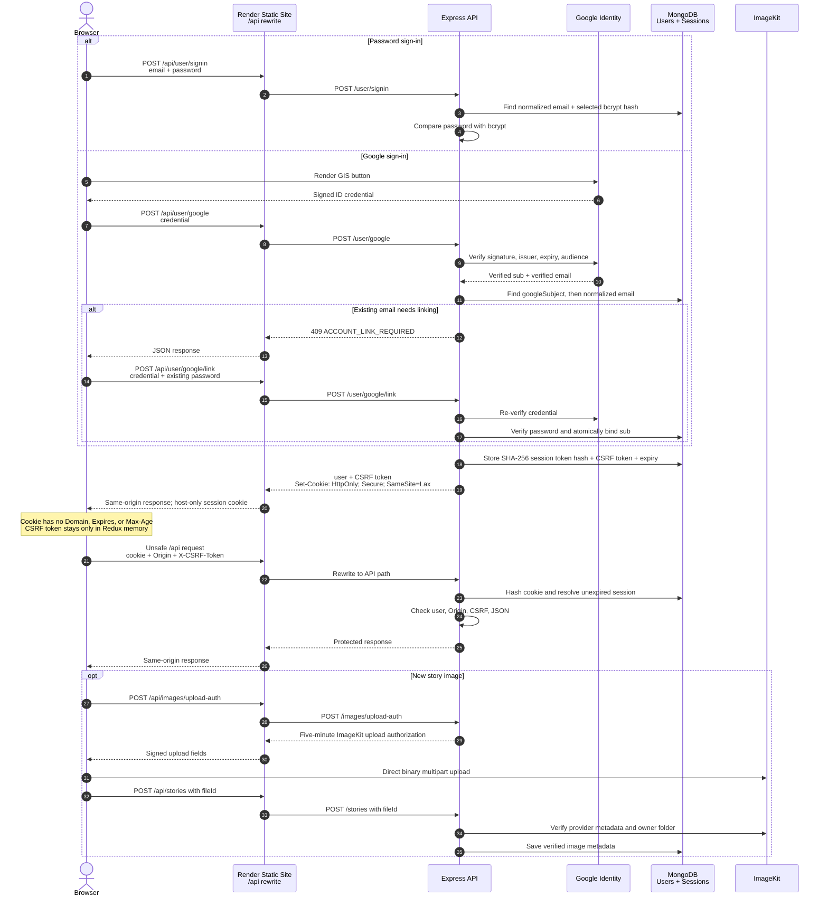

# Instaverse API

Express + TypeScript API for [Instaverse](https://github.com/teemo007/Instaverse).
It supports password and Google authentication through revocable MongoDB
sessions, plus direct-to-ImageKit story uploads.

Use Node.js 20.9 or later. Copy `.env.example` to `.env` locally and provide
values through Render environment variables in production. Never put MongoDB,
ImageKit, or other server credentials in the Vite environment.

## Authentication architecture



The browser never stores or reads a session token, JWT, Google access token, or
Google refresh token. Only Google's stable `sub` is stored on a user. Session
documents contain the hash of a random cookie token, a separate CSRF token, and
a 24-hour expiry. Password hashes are excluded from normal user queries.

The session cookie is browser-session scoped because it has no `Expires` or
`Max-Age`. Browser “restore previous session” settings can restore session
cookies after a restart; the server cannot reliably observe a browser-close
event. Sign out explicitly revokes the session immediately.

## Environment

| Variable | Purpose |
|---|---|
| `MONGO_URI` | MongoDB connection string (secret) |
| `PORT` | Local/server port; Render normally provides it |
| `GOOGLE_CLIENT_ID` | Google Web OAuth client ID used as ID-token audience |
| `FRONTEND_ORIGIN` | Exact frontend origin, for example `https://your-site.onrender.com` |
| `JWT_SECRET` | Temporary rollback compatibility only; retain until rollout verification is complete |
| `IMAGEKIT_PUBLIC_KEY` | ImageKit public key |
| `IMAGEKIT_PRIVATE_KEY` | ImageKit private key (secret) |
| `IMAGEKIT_URL_ENDPOINT` | ImageKit delivery endpoint |

Production startup fails if `GOOGLE_CLIENT_ID` or `FRONTEND_ORIGIN` is absent.
Do not add a Google client secret: this flow verifies browser-issued ID
credentials and does not exchange authorization codes.

## Run and verify

```bash
npm install
npm run dev
npm test
npm run typecheck
npm run build
```

Before enabling the unique normalized-email index, run the read-only preflight:

```bash
npm run check:duplicate-emails
```

Resolve every reported duplicate deliberately, then create the index:

```bash
npm run create:user-indexes
```

The index command refuses to proceed while duplicates remain.

## Render web service

Configure the API as a Render Web Service:

```text
Build Command: npm ci && npm run build
Start Command: npm start
Health/diagnostic origin: https://<api-service>.onrender.com
```

Add all server environment variables from the table above in Render. Set
`NODE_ENV=production`, set `FRONTEND_ORIGIN` to the frontend's exact HTTPS
origin without a path, and use the same Google Web client ID as the frontend.
Keep `JWT_SECRET` during the rollback window even though the new session flow
does not read it.

The frontend must proxy `/api/*` through its Static Site rewrite. Direct
cross-origin calls to the API origin are not the supported authenticated browser
path because the host-only cookie belongs to the frontend host.

## Release verification and rollback

After both services deploy:

1. Verify password sign-up/sign-in and Google-only sign-in.
2. Verify an existing password account receives the linking prompt, rejects a
   wrong password, then links with the correct password.
3. Refresh the page and confirm `GET /api/user/session` restores the user.
4. In browser DevTools, inspect the frontend-origin cookie: `HttpOnly`,
   `Secure`, `SameSite=Lax`, no `Domain`, no `Expires`, and no `Max-Age`.
5. Confirm unsafe calls send `Origin` and `X-CSRF-Token`, while foreign origins
   and missing/wrong CSRF tokens are rejected.
6. Sign out and confirm the session can no longer restore.
7. Close and reopen the browser to test its session-cookie behavior, noting the
   browser session-restore limitation described above.

For rollback, keep `JWT_SECRET`, restore the last JWT-capable backend release,
then immediately restore the matching legacy frontend release. Do not delete
new session or Google user fields; older code ignores them. Remove `JWT_SECRET`
only after the new deployment and rollback window are both complete.

## Image uploads

The signed upload endpoint requires an active session, valid Origin and CSRF
token, and disables caching. Files upload directly to ImageKit under
`/instaverse/stories/<userId>`. Saving a new image verifies provider metadata
and the user folder; client-supplied URLs and dimensions are never trusted.
Accepted images are JPEG, PNG, WebP, GIF, and AVIF up to 5 MB.

The existing `image` field contains a CDN URL. Optional `imageFileId`,
`imageWidth`, and `imageHeight` accompany new images. Legacy Base64 stories
still render and support caption/tag edits; new Base64 submissions are rejected.

Run the live ImageKit probe only with local credentials and network access:

```bash
npm run verify:imagekit
```

It uploads a temporary frontend logo, verifies signed-folder and CDN behavior,
and deletes the temporary file in `finally`. It never modifies MongoDB.

## Migrate legacy Base64 images

Read-only preflight:

```bash
npm run migrate:images
```

Apply uploads and database replacements:

```bash
npm run migrate:images -- --apply
```

The script backs up original image fields under `.image-migrations/run-*`,
verifies every upload before changing MongoDB, and protects concurrent edits.
Keep that ignored backup directory until the migration is accepted; it contains
original images, not credentials.

Resume or restore with the exact reported run directory:

```bash
npm run migrate:images -- --resume .image-migrations/run-EXAMPLE --apply
npm run migrate:images -- --restore .image-migrations/run-EXAMPLE
npm run migrate:images -- --restore .image-migrations/run-EXAMPLE --apply
```

Rollback restores only image records that still match the migration's verified
URL and file ID. It does not overwrite later edits or delete ImageKit media.
