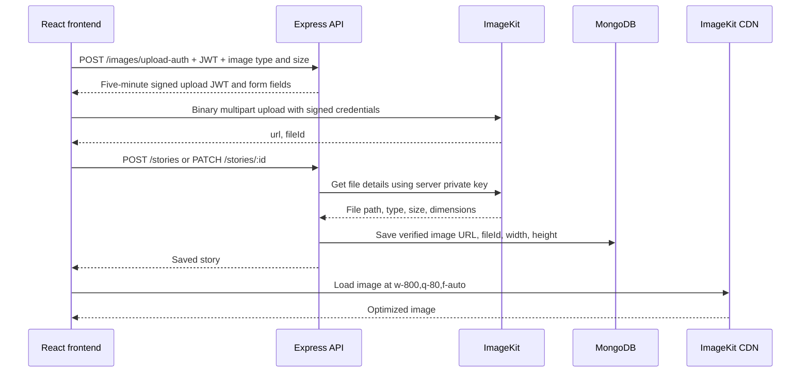

# Instaverse API — ImageKit integration

Use Node.js 20.9 or later. Configure the API's `.env` with `MONGO_URI`,
`JWT_SECRET`, `IMAGEKIT_PUBLIC_KEY`, `IMAGEKIT_PRIVATE_KEY`, and
`IMAGEKIT_URL_ENDPOINT` (see `.env.example`). No ImageKit key belongs in the
Vite environment. The frontend only needs its existing `VITE_API_URL`.
Restart the API after changing configuration.

## Architecture



The signature endpoint requires a signed-in user and disables caching.
ImageKit's Upload V2 API validates signed form fields, binding the user
folder, generated filename, MIME/size checks and no-overwrite option to
the upload JWT. V2 is currently labelled beta by ImageKit; the real
upload/CDN probe below verifies compatibility with the configured account.
Files are uploaded under `/instaverse/stories/<userId>`. Saving a new image
verifies its provider metadata and user folder; client-supplied URLs and
dimensions are never trusted. Accepted images: JPEG, PNG, WebP, GIF and
AVIF, up to 5 MB. Story edits and deletes require ownership.

The existing `image: string` field now contains a CDN URL. Optional
`imageFileId`, `imageWidth`, and `imageHeight` accompany new images.
Legacy Base64 stories still render and support caption/tag edits without
re-uploading. New Base64 submissions are rejected. Feed images are
optimized; the image preview uses the original URL.

## Run and verify

From this directory:

```bash
npm run dev
npm run test
npm run verify:imagekit
```

`verify:imagekit` uses local credentials to upload the frontend's logo into
a unique verification folder, confirms modified signed folders are rejected,
checks metadata and optimized CDN delivery,
then deletes that temporary file in `finally`. It never modifies MongoDB.
Network access and ImageKit write/read permissions are required.

From `../Instaverse`:

```bash
npm run dev
npm run test
npm run lint
npm run build
```

For a browser check, sign in, create a story with an image, refresh, edit
the caption, and replace the image. DevTools should show a multipart
request to `upload.imagekit.io` and a story JSON request containing a URL
and fileId rather than Base64. The feed should load the image from your
configured ImageKit URL endpoint.

## Media lifecycle

Old MongoDB images are migrated with the explicit command below. Uploads
are retained if a post save is abandoned; replacing or deleting a story
also retains the media file. This avoids deleting assets referenced by
other stories. Use the ImageKit media library to manage unused images;
automated reference-aware cleanup is a follow-up.

## Migrate legacy Base64 images

From this directory, preflight validates legacy images without uploads,
backups or database writes:

```bash
npm run migrate:images
```

Apply uploads and database replacements:

```bash
npm run migrate:images -- --apply
```

The script first saves every original image field and its optional metadata
under a new `.image-migrations/run-*` directory. The directory is ignored by
Git and backup files are owner-readable only. Keep it until you are satisfied
with the migration; it contains original images, not credentials.

Images up to 5 MB retain their bytes. Larger images are auto-oriented,
resized to fit 2048 × 2048 without enlargement and encoded as WebP at quality
85. Original files remain in the local backup. Every upload's ImageKit metadata
and optimized CDN response are verified before MongoDB changes. Only image
fields are updated; captions, authors, dates, likes and comments are preserved.
Updates match both the owner and original image to protect concurrent edits.

Each run prints its backup directory. To resume, substitute that exact directory:

```bash
npm run migrate:images -- --resume .image-migrations/run-EXAMPLE --apply
```

Resume skips migrated/deleted posts and reuses recorded uploads. Failures and
concurrent changes are reported with a nonzero exit status; backups remain.
An interruption between upload acceptance and receipt persistence may leave
an unreferenced ImageKit file. No remote files are deleted automatically.

To preview a rollback, then explicitly apply it:

```bash
npm run migrate:images -- --restore .image-migrations/run-EXAMPLE
npm run migrate:images -- --restore .image-migrations/run-EXAMPLE --apply
```

Rollback restores only images that still match this migration's verified URL
and fileId. It does not overwrite later edits or delete ImageKit media.
